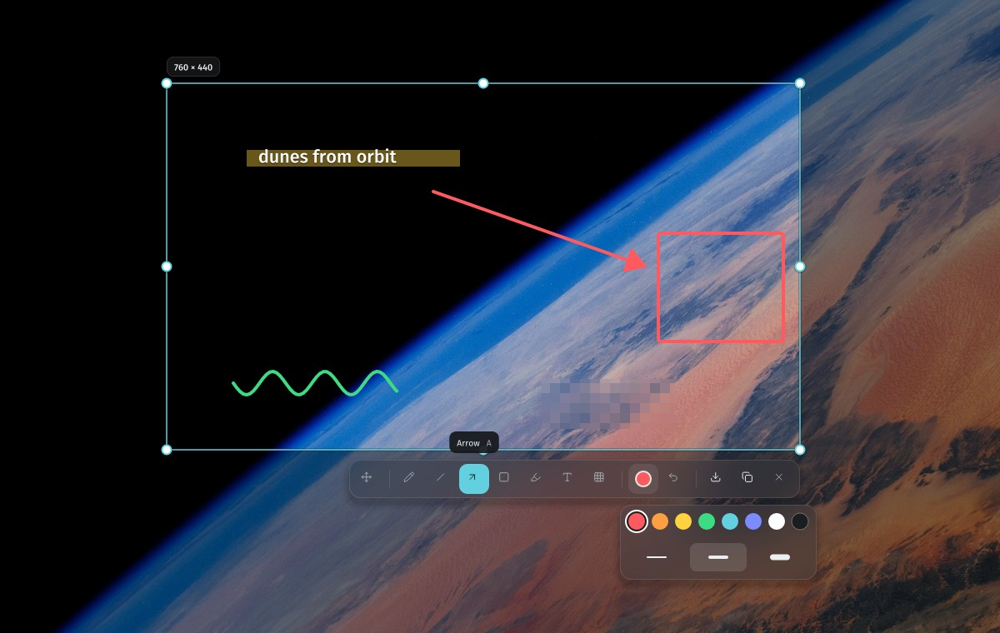

# JamShot

A fast, Lightshot-style screenshot tool for the [COSMIC](https://system76.com/cosmic) desktop.
Press a shortcut, the screen freezes, drag a region, draw on it right where it is, and copy.



JamShot talks to the compositor directly over Wayland and renders everything on the CPU, so there is no
GUI toolkit to load. The overlay is on screen about 0.1 s after you press the key, and a frame redraws in
about 5 ms on a laptop.

## Features

- Frozen, dimmed screen with a resizable selection: drag the corners or edges, and move the whole frame
- Annotations drawn in place: pen, line, arrow, rectangle, highlighter, text and pixelate
- 8 colors and 3 stroke sizes; scroll the mouse wheel to change the size
- Unlimited undo
- Copy to the clipboard as PNG, or save to `~/Pictures/Screenshots` with a desktop notification
- Follows your COSMIC accent color and light/dark theme
- Multi-monitor: every screen freezes and you select on whichever one you like
- Shortcuts work on any keyboard layout, Cyrillic included
- English and Ukrainian interface

## Keys

| Key | Action |
| --- | --- |
| Drag | Select a region |
| `V` | Move or resize the selection |
| `P` / `L` / `A` / `R` | Pen / line / arrow / rectangle |
| `M` / `T` / `B` | Highlighter / text / pixelate |
| `C` or mouse wheel | Color and size |
| `Ctrl+Z` | Undo |
| `Enter` or `Ctrl+C` | Copy to clipboard and close |
| `Ctrl+S` | Save to `~/Pictures/Screenshots` and close |
| `Esc` or right click | Close without saving |

While typing text, `Enter` finishes the label and `Shift+Enter` starts a new line.
`Enter` with nothing selected copies the whole screen under the cursor.

## Install

You need a Rust toolchain (1.85+), plus `wl-clipboard` for copying and `fontconfig` to find a font.
Fira Sans is used when it is installed; otherwise your default sans-serif font is used.

```bash
git clone https://github.com/Jemaver/jamshot
cd jamshot
cargo build --release
install -Dm755 target/release/jamshot ~/.local/bin/jamshot
```

Then open the keyboard shortcuts page in COSMIC Settings and add a custom shortcut with the command `jamshot` (or the full path `~/.local/bin/jamshot`). `Print` is a good choice; remove
or rebind the built-in screenshot shortcut first.

### Compositor support

JamShot needs `ext-image-copy-capture-v1`, `wlr-layer-shell` and `wp-viewporter`. It is built and tested on
COSMIC. Other compositors that implement these protocols should work but have not been tested.

## Language

The interface follows `LANG`. To pick a language explicitly, set `JAMSHOT_LANG=uk` or `JAMSHOT_LANG=en`, or
write `uk` or `en` to `~/.config/jamshot/lang`.

## How it works

1. Captures every output with `ext-image-copy-capture-v1` into shared memory.
2. Opens one fullscreen `wlr-layer-shell` overlay per output and shows the frozen frame, dimmed.
3. Draws the selection, annotations and toolbar with [tiny-skia](https://github.com/linebender/tiny-skia).
   The toolbar's frosted glass is a pre-blurred copy of the captured screen, so it costs nothing per frame.
4. On copy or save, it crops the original capture, replays the annotations at full resolution and
   encodes a PNG.

`jamshot --test-render <input.png> <out-dir>` renders a sample scene without a display. It is handy for
checking UI changes.

## Credits

- Icons: [Lucide](https://lucide.dev) (ISC License)
- Screenshot background: "Otherworldly Earth", NASA ISS064-E-29444 (public domain), from the COSMIC wallpapers

## License

[MIT](LICENSE)
